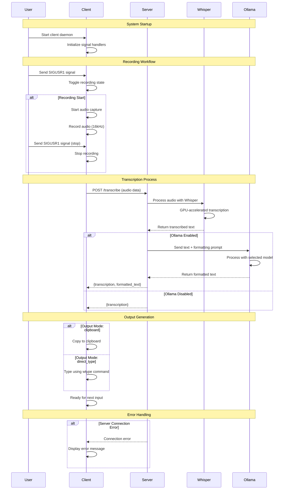

[https://zenn.dev/yadokani389/articles/whisper-typing-20250720](https://zenn.dev/yadokani389/articles/whisper-typing-20250720)のミラーです。

## はじめに

最近、Aqua Voiceやsuperwhisperといった音声入力ツールが流行っている気がします。
しかし、Linuxに対応しているものが少なかったり、ローカル環境で動作するWhisperモデルを活用したツールが見当たらなかったりすることに気づきました。
そこで、OpenAIのWhisperモデルを利用した無料の音声入力システムを開発しましたので、本記事で紹介します。

サーバー・クライアント構成にすることで、家の高性能GPUを活用しながら、軽量なノートPCからでも快適に音声入力できる仕組みを実現しました。

https://github.com/yadokani389/whisper-typing

https://x.com/yadokani389/status/1946570676980297822

## 特徴

- **サーバー・クライアント分離**
- **Ollama統合**
- **複数の出力モード**: クリップボードへのコピーまたは直接入力
- **シンプルな操作**: シグナルによるトグル制御
- **システムトレイ対応**: 視覚的な状態表示

## 動作環境

このツールは、以下の環境を想定しています。

- **OS**: Linux
- **ディスプレイサーバー**: Wayland環境を推奨する。
  - X11環境でもクリップボードモードは利用できる。ただし、直接入力モードは `wtype` コマンドに依存するため、Waylandが必要である。
- **ハードウェア**:
  - **サーバー側**: 高速な文字起こしには、NVIDIA製GPUとCUDA環境を強く推奨する。
  - **クライアント側**: 特別な要件はない。

## アーキテクチャ

### 全体構成

処理の流れは次のとおりです。

- 1. ユーザーがクライアントにシグナルを送る（≒キー入力）。
- 2. クライアントが録音する。
- 3. もう一度シグナルを送る。
- 4. 録音が止まる。
- 5. サーバーに音声データが送られ、文字起こしされる。
- 6. 起こされた文章が入力される。

## 工夫したポイント

### サーバー・クライアント分離

最初はすべてを1つのファイルで実行していました。GPUのないノートパソコンでも使いたいと考え、デスクトップに文字起こしを任せれば実用的な速度で処理できると思いました。そこで、サーバー・クライアント構成にしました。
デバイス間の通信は、ポートを開放せずにTailscaleで行えます。

### シグナルを使った録音の制御

音声入力の開始・終了を無音状態の検知に頼る方式は、あまり好みではありませんでした。無音部分を文字起こしすると、学習データの影響で「ご視聴ありがとうございました」など、意図しないテキストまで出力される場合があります。使い勝手も悪かったため、シグナル方式を採用しました。
毎回コマンドを打つ手間を省きつつ、自分のタイミングで正確に録音を制御したいと考え、シグナルによるトグル方式を採用しました。これにより、クライアントを常駐させたまま、簡単なキー操作で録音の開始と停止を切り替えられます。
私は `Windowsキー + D` のショートカットでシグナルを送信するように設定しています。

## サーバー側の実装

FastAPIを使いシンプルなREST APIで音声ファイルを受け取り、テキストを返します。
faster-whisperを使用して文字起こししています。

### Ollamaによる整形

上で挙げた音声入力ソフトはカスタムプロンプトがあると聞いたので、Ollamaを使ってllmで整形できるようにしてみました。とは言ってもOllamaのAPIを使って設定したプロンプトと文章を送ってその出力を返すだけですが。

## クライアント側の実装

### 音声録音の制御

このプロセスにSIGUSR1シグナルが来ると録音がトグルされます。
`setproctitle`でタイトルをつけているので`pkill -SIGUSR1 whisper-typing`で送ることができます。
録音はsounddeviceライブラリを使用しました。

### 出力モードの選択

2つの出力モードが選択可能です。

1. **クリップボードモード**: `pyperclip`でクリップボードにコピー
2. **直接入力モード**: `wtype`コマンドで直接テキスト入力

クリップボードモードでは自分でペーストする必要があり、手間がかかります。`wtype`が動かない環境で使うためのモードです。
`wtype`はWayland専用です。ほかの環境でも使える方法が見つかれば、対応したいと考えています。

### システムトレイ機能

`pystray`で視覚的な状態確認のためのトレイアイコンを実装しました。

- **緑**: 待機中（録音可能）
- **赤**: 録音中
- **グレー**: 停止/エラー

## おわり

私自身はPythonでの開発経験が豊富なわけではありませんが、`faster-whisper` を利用する上でPythonの採用は避けられませんでした。また、依存関係をシンプルに保つため、クライアント側もPythonで実装することにしました。
Pythonの開発経験が豊富ではないため、コードには改善の余地が残っている可能性があります。より良い実装方法や改善点に気づいた方は、ぜひGitHubのIssueなどでフィードバックをいただけると嬉しいです！
