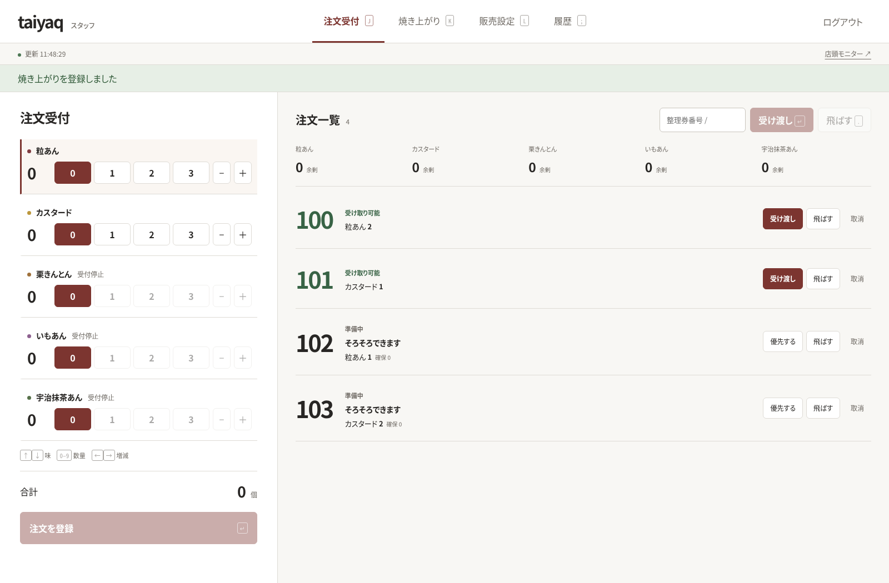
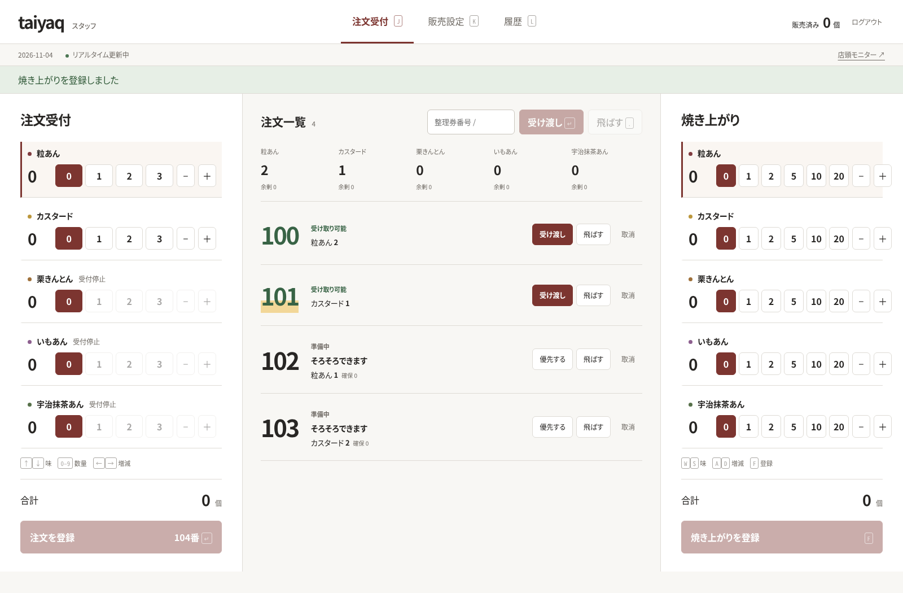

今年の文化祭でもたい焼きを販売しました。
僕はサブリーダーのような立場で準備や運営に関わりながら、昨年作った注文・受け取り管理システム[taiyaq](/works/20260129-taiyaq/)も作り直して使いました。

taiyaqでは、スタッフが店頭で注文を登録して整理券を渡します。来場者はWebサイトや店頭のディスプレイから、注文が受け取り可能になったか確認できます。

昨年の経験から操作しやすい画面を目指していたものの、実際に運用すると、想定していなかった問題がいくつも見つかりました。システムだけでなく、人や材料のやりくりも大変だったので、あわせて振り返ります。

## Cloudflareへの移行

昨年のtaiyaqは自宅サーバーで動かし、Tailscale
Funnelを使って外部に公開していました。ところが一度Funnelの調子が悪くなり、途中でCloudflare
Tunnelに変更しました。

今年は、自宅サーバーとトンネルを使うよりも、全部Cloudflareにデプロイした方が楽かなと思い、Cloudflare
WorkersとD1を使う構成に移行しました。画面はReact、サーバー側はTypeScriptで作っています。
移行してみると、やはり管理がとても楽でした。特に今はAIに
[cf](https://blog.cloudflare.com/ja-jp/cloudflare-cf-cli-launch)
を使わせて全部やってもらえるので、
デプロイや公開のことを考えなくていいのがよかったです。

## 操作のしやすさと整理券

昨年は注文数を数字で入力していましたが、販売中に毎回入力するのは時間がかかりました。そこで途中から、3個くらいまでのよく使う数量は、マウスで数字を押すだけで選べるようにしました。

今年もその経験を踏まえて、マウスですぐに操作できることと、キーボードだけでも操作を完結できることを意識しました。注文のたびに数字を入力するより、マウスやキーボードですぐ操作できる方が楽だと考えたからです。

整理券番号の仕様も、実際の運用に合わせて変わりました。昨年は整理券を手書きしていたので、回収した整理券を再利用できる方が楽だよね、という話がありました。そのため、今年のシステムも当初は番号を01から99までループさせるようにしていました。

ですが、今年は整理券を名刺に印刷したので、番号をループさせる必要はなくなりました。
状況によって最適な仕様は変わるんだなと思いました。

## 初日に使って分かったこと

### 似た画面を間違える

初日は、注文受付と焼き上がり登録が別のタブになっていました。注文を受け付けながら焼き上がりを登録するには、タブを切り替える必要がありました。

切り替え自体が面倒だったうえ、2つの画面の見た目がよく似ていました。そのため、注文受付と焼き上がり登録の画面を取り違えてしまうことがありました。どちらの画面にいるかをすぐに見分けられることも大事だと感じました。

そこで初日の後、注文受付と焼き上がり登録を同じ画面にしました。

### トレーの数と販売数を確認する

スタッフ画面には余剰在庫を表示していました。これは、トレーにあるたい焼きのうち、すでに注文に確保した分を引いた数です。

そのため、トレーに実際に並んでいる数と画面の数字を比べるには、余剰在庫に確保分を足す必要がありました。毎回計算するのは面倒だったので、確保分を含めた在庫の総数も表示するようにしました。

また、販売してよい数には上限がありました。どれだけ売ったかすぐに確認できるよう、販売数も表示しました。

### 別のパソコンに注文がすぐ表示されない

注文受付と焼き上がり登録は別のパソコンで行っていました。初日は5秒ごとのポーリングで情報を更新していたため、片方のパソコンで受け付けた注文が、もう片方にすぐ表示されないことがありました。

そこで、スタッフ画面の更新にWebSocketを使うようにしました。接続が切れた場合は、定期的な取得に切り替わります。

### 拡声器で呼び出す番号を見分ける

来場者向けのサイトと店頭ディスプレイを用意していたものの、屋外では日差しがまぶしく、画面が見えにくい状態でした。そのため、実際には拡声器で整理券番号を呼び出していました。

ところがスタッフ画面では、どの注文が新しく受け取り可能になったのか分かりづらい状態でした。そこで、新しく受け取り可能になった注文を強調表示し、呼び出す番号を見分けられるようにしました。

<figure>

{/* textlint-disable ja-technical-writing/ja-no-mixed-period */}

<figcaption className="text-center text-sm text-ink-500">変更前</figcaption>

{/* textlint-enable ja-technical-writing/ja-no-mixed-period */}

</figure>

<figure>

{/* textlint-disable ja-technical-writing/ja-no-mixed-period */}

<figcaption className="text-center text-sm text-ink-500">変更後</figcaption>

{/* textlint-enable ja-technical-writing/ja-no-mixed-period */}

</figure>

## 2日目にD1の読み取り制限に達した

文化祭の2日目販売が終わった直後に、Cloudflare
D1の無料枠の読み取り制限に達してしまいました(まじで危なかったです)。
そんなに激しく使っていたつもりはなかったので、後日Cloudflareの分析データとコードを調べました。

調べてみると、状態を取得するたびに、完了した注文から販売数を集計していました。公開画面は5秒ごとに状態を取得し、スタッフ画面ではWebSocketでリアルタイム更新する仕組みにしていましたが、注文などの操作があるたびに最新の状態を読み取って配信していました。どちらも画面を開いているだけでも集計が繰り返される構造でした。

分析データでは、完了した注文の販売数を合計するクエリが推定約561万行を読み、taiyaqの読み取りの約85％を占めていました。残りのうち、未完了の注文を取得するクエリも約95万行を読んでいました。どの画面が何回リクエストしたかまでは分かっていませんが、繰り返し行われる集計が読み取り量を増やしていました。

状態を取得するたびに完了注文を集計するのではなく、商品を受け渡したときに販売数を保存し、状態取得時にはその値を読む実装に変更しました。あわせて、処理中の注文を取得するための部分インデックスも追加しました。

販売数を表示する機能は初日の夜に追加しましたが、その集計が状態を取得するたびに実行されることまで確認できていませんでした。
小さな機能追加でも、繰り返し呼ばれる処理に入れると、データが増えるにつれて負荷が大きくなることを経験しました。

次は表示や計算結果の正しさに加え、SQLの実行タイミングや回数、読み取る行数も確認したいです。
AIに実装を任せる場合も、この確認をレビューの項目に入れます。

## 人手不足と材料の買い足し

模擬店の運営では、インフルエンザで参加できない人がいたうえに、初日にも風邪で休む人が出て、さらに人手が減ってしまいました。
リーダーも風邪で5時ごろから連絡が取れなくなり、サブリーダーのような立場だった僕が判断することになりました。
2日目のシフトを考える必要があり、急遽Formsを作って参加できる人を確認したりしました。

生地の仕込みにも人手が必要でした。昨年は薄力粉や卵から生地を作っていたので時間がかかり、丸一日ずっと生地を作っている人もいました。今年は同じような負担をかけたくなくて、水を加えるだけで作れるたい焼き粉を用意していました。

ところが、その粉も予定より多く使っていて、このままでは足りなくなりそうでした。買い足すかどうか、買うならどのくらい必要かを決めなければなりませんでした。生地作りに何人必要かも考えながら、少ない人手でどこまで販売を続けるか判断するのが大変でした。

僕も疲れていたので、粉を買い足さずに早く販売を終えてもいいかなと思っていました。でも、友達が「生地作るからやろうよ」と言ってくれたので、パンケーキミックスを買い足して販売を続けられるようにしました。

2日目は、リーダーも体調が悪い中で来てくれました。本来はシフトに入れない人たちも手伝ってくれて、なんとか運営できました。大変だったけれど、結果的にはやってよかったです。

ちなみに、たい焼き粉とパンケーキミックスの味は、ほとんど違いが分からないくらい同じでした。

## 振り返り

taiyaqは実際に店頭で使うことを考えて作ったつもりでしたが、自分で受付を担当したり、他のスタッフの意見を聞いたりする中で、想定していなかった問題がいくつも見つかりました。
使う人がどんな状況で、どんな流れで作業しているのかを知ることが、使いやすさを考えるうえで大事だと感じました。

次に何か作るときは、早い段階から使う人に試してもらい、その反応を見ながら設計を考えていきたいです。
