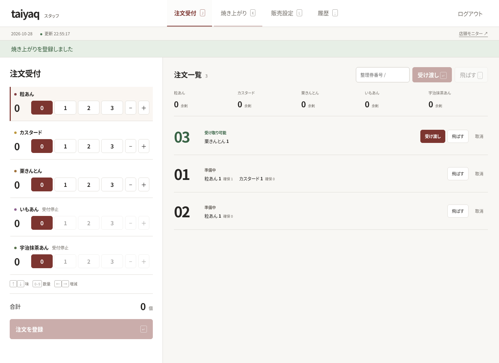
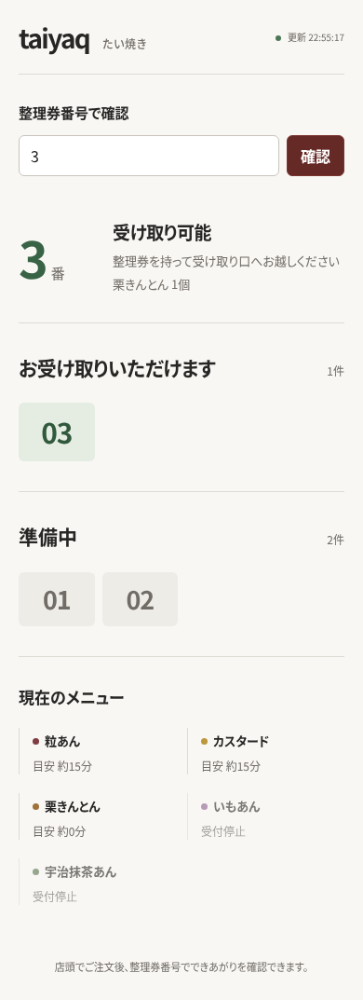
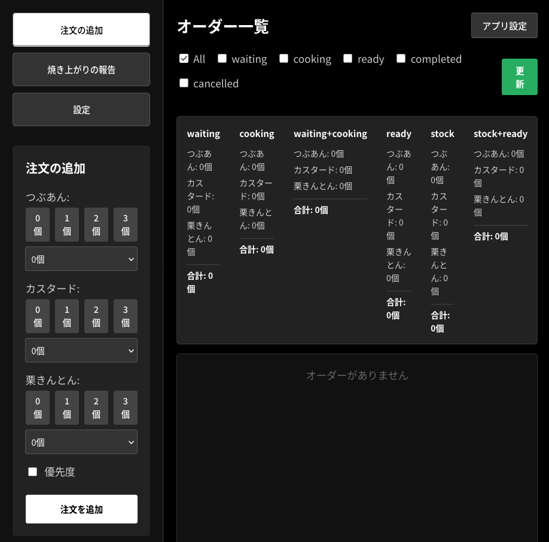

https://github.com/yadokani389/taiyaq

2025年の文化祭で使用した、たい焼きの注文・受け取り管理システム「taiyaq」を、2026年の文化祭に向けてリメイクしました。
RustとVueを使用した旧版から、TypeScript、React、Cloudflare Workers、D1を使う構成に作り直しています。
2026年の文化祭で使用する予定です。

スタッフが注文と焼き上がりを登録し、来場者は整理券番号から受け取り状況を確認できます。

## 2026年版でできること

- スタッフが注文受付、焼き上がり登録、受け渡し、キャンセルを行う
- 来場者がWebページで自分の注文状況と待ち時間の目安を確認する
- 店頭モニターに受け取り可能な整理券番号を表示する
- 味ごとの受付状況や在庫を管理し、注文と販売の履歴を確認する
- 受け取りに来ていない注文を保留し、あとから列に戻す

焼き上がった商品は味ごとに注文順で確保し、すべての商品が揃った注文を受け取り可能にします。
整理券番号は1〜99を循環し、使用中の番号を避けて再利用します。

## 2026年版の画面

テスト用の注文データを使って撮影した、2026年版の画面です。

スタッフ画面では、注文を登録し、受け渡し状況を確認します。

来場者は、スマートフォンから整理券番号の状況を確認できます。

## 使いやすさの工夫

販売中にマウスとキーボードを何度も持ち替えずに操作できるよう、通常操作はキーボードだけでも完結できるようにしました。
数量の選択や注文・焼き上がりの登録に加え、整理券番号を使った受け渡しの確認にも対応しています。

また、受け渡しはすぐに対応する必要があるため、どのタブを開いていても受け渡し画面を確認できるようにしました。
注文を登録する人と商品を受け渡す人、それぞれの操作場面を考えています。

## 注文処理の工夫

複数のスタッフによる操作が重なった場合も、注文や在庫の状態を一貫して更新できるようにしています。
また、注文受付や焼き上がり登録に操作IDを付け、通信時に同じ操作が再送されても重複して反映されないようにしました。

バックエンドはTypeScriptのCloudflare Worker、データの保存にはCloudflare D1を使っています。
来場者向けの閲覧とスタッフの更新操作は権限を分け、スタッフの更新はサーバー側で認証します。

## 旧版の記事（2025年版）

ここから下は2025年の文化祭で使用した旧版について、以前掲載していた記事です。
記載されているRust・Vueの構成やDiscord・LINE通知は旧版のもので、2026年版の説明ではありません。
画像も旧版のスタッフ画面です。

2025年に文化祭でたい焼きを出した時の呼び出し・受け取りをまとめて管理するシステムです。
支払い時に予約番号を発行し、並ばなくても受け取れるようにしました。

文化祭の食品販売では、注文の管理、焼けた数の共有、受け取り待ちの案内を紙や声かけだけで回すと混乱しやすいです。
この作品では、スタッフが注文数と焼き上がり数を入力するだけで、予約番号の発行、受け取り可能番号の表示、通知までをまとめて扱えるようにしました。

### できること

- 予約番号の発行と注文状況の管理
- Webページで呼び出し中番号と待ち時間の確認
- Discord / LINE で通知登録し、焼き上がり時に自動通知
- スタッフ画面から焼き上がり数の登録と受け渡し完了処理
- 店頭ディスプレイに受け取り可能番号を大きく表示

バックエンドはRustで、フロントはVueを使用しています。
フロントはスタッフ用操作画面,店頭用,ユーザー用の3つがあります。
操作画面では入った注文と焼き上がったたい焼きの個数を入力します。
すると自動的に注文番号にたい焼きが割り当てられ、通知設定をしたユーザーにはメッセージが送られます。

ユーザーはWebページから現在呼び出されている番号や待ち時間を確認できます。
通知を登録しておけば、焼き上がったタイミングでDiscordまたはLINEにメッセージが届くため、売り場の前で長時間待つ必要がありません。

店頭用の画面では、受け取り可能な番号を大きく表示します。
スタッフ用の画面、ユーザー用の画面、店頭表示を分けることで、実際の運用で必要な情報だけをそれぞれの場所へ出せるようにしました。
